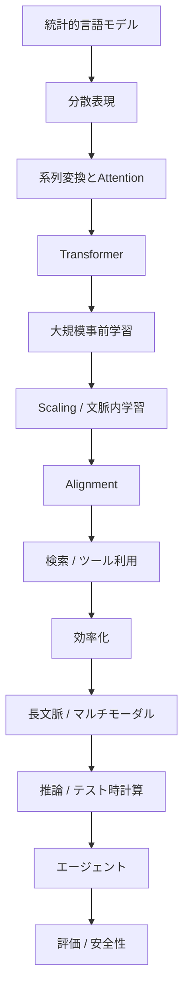

# LLMの技術史を論文で追う

言語モデルという技術が、何を課題にし、どの発想でそれを越え、その結果どの課題を残してきたかを、論文を1本ずつ読んでたどるための台帳である。モデルの優劣ではなく、系譜を追う。

対象は、統計的言語モデルから、分散表現、系列変換とAttention、Transformer、大規模事前学習、スケーリングと文脈内学習、アライメント、検索とツール利用、効率化、長文脈とマルチモーダル、推論とテスト時計算、エージェント、評価と安全性までである。

## 読み方

1. Issueを立てる。テンプレート「論文を読む」を使い、タイトルは `[L01] <論文名>` とする。本文の論文ID、リンク、系譜を、下の表から写す。
2. 論文を読む。PDFは `papers/` に置ける。このディレクトリの PDF はリポジトリにコミットしない。
3. 読書メモを、その Issue のコメントに書く。節の型は [`notes/TEMPLATE.md`](notes/TEMPLATE.md)。論文に書いてあること【論文の事実】と、自分の読み【解釈】は分けて書く。
4. Issue 本文のチェックリストを埋める。
5. 読み終えたら Issue を Close する。
6. この README の表で、その行の状態を更新する。Issue 列には、立てた Issue の番号を書く。

状態の初期値はすべて未読である。読み終えた行は、状態を「読了」に変える。2025年と2026年の論文は、元にした調査レポートの区分に合わせ、未読（査読済み）または未読（プレプリント）と書いてある。

## 系譜

並びは上の段階順である。同じ段階のなかでは、最初に公開されたものが先である。年の列は、査読版があるものはその掲載年、arXiv のみのものは投稿年である。そのため、段階のなかで年の数字が前後することがある。Switch Transformers（L26）は arXiv 2021 年、掲載は JMLR 2022 年なので、年は 2022 だが、LoRA（L27、2021）より前に置く。Bahdanau らの attention（L06）は arXiv では Sutskever ら（L05）より 9 日早いが、系譜では系列変換の次に置く。

掲載年と arXiv 年が異なるもの: L06 は arXiv 2014 / ICLR 2015、L09 は arXiv 2018 / NAACL 2019、L10 は arXiv 2019 / JMLR 2020、L19 は arXiv 2022 / ACL 2023、L23 は arXiv 2022 / ICLR 2023、L26 は arXiv 2021 / JMLR 2022、L37 は arXiv 2023 / TACL 2024、L43 は arXiv 2023 / ICLR 2024。

## 論文

全 46 件。リンクは arXiv の abs ページを優先し、arXiv がないものは公式の掲載ページである。L45 と L46 は、調査レポートが題名を示しておらず、こちらでも一意に特定できなかった。

| ID | 年 | 系譜（段階） | 論文タイトル（英語原題） | 著者（筆頭 et al.） | リンク | 状態 | Issue | メモ |
| --- | --- | --- | --- | --- | --- | --- | --- | --- |
| L01 | 1995 | 統計的言語モデル | Improved backing-off for M-gram language modeling | Kneser et al. | https://doi.org/10.1109/ICASSP.1995.479394 | 未読 |  | 直前の数語から次の語を予測する統計的言語モデルの代表で、後年も modified Kneser–Ney が強い基準として残る。 |
| L02 | 2003 | 分散表現 | A Neural Probabilistic Language Model | Bengio et al. | https://www.jmlr.org/papers/v3/bengio03a.html | 未読 |  | n-gram の疎性を、単語の連続ベクトルとニューラル確率モデルで一般化した。 |
| L03 | 2013 | 分散表現 | Distributed Representations of Words and Phrases and their Compositionality | Mikolov et al. | https://arxiv.org/abs/1310.4546 | 未読 |  | Skip-gram と negative sampling で、大規模な単語埋め込み学習を現実的にした。 |
| L04 | 2014 | 系列変換とAttention | Learning Phrase Representations using RNN Encoder-Decoder for Statistical Machine Translation | Cho et al. | https://arxiv.org/abs/1406.1078 | 未読 |  | GRU と encoder–decoder という、系列変換の重要な前史。 |
| L05 | 2014 | 系列変換とAttention | Sequence to Sequence Learning with Neural Networks | Sutskever et al. | https://arxiv.org/abs/1409.3215 | 未読 |  | 可変長の入力から可変長の出力を、encoder–decoder で統一した。 |
| L06 | 2015 | 系列変換とAttention | Neural Machine Translation by Jointly Learning to Align and Translate | Bahdanau et al. | https://arxiv.org/abs/1409.0473 | 未読 |  | 出力のたびに入力の関連箇所を参照し、固定長ベクトルのボトルネックを緩和した。 |
| L07 | 2017 | Transformer | Attention Is All You Need | Vaswani et al. | https://arxiv.org/abs/1706.03762 | 未読 |  | 再帰を捨て、self-attention で系列の依存関係を並列に計算する設計を示した。 |
| L08 | 2018 | 大規模事前学習 | Deep Contextualized Word Representations | Peters et al. | https://arxiv.org/abs/1802.05365 | 未読 |  | 静的な単語ベクトルから、文脈で意味が変わる表現への橋渡し。 |
| L09 | 2019 | 大規模事前学習 | BERT: Pre-training of Deep Bidirectional Transformers for Language Understanding | Devlin et al. | https://arxiv.org/abs/1810.04805 | 未読 |  | マスク言語モデルにより、左右の文脈を同時に使う深い事前学習を実現した。 |
| L10 | 2020 | 大規模事前学習 | Exploring the Limits of Transfer Learning with a Unified Text-to-Text Transformer | Raffel et al. | https://arxiv.org/abs/1910.10683 | 未読 |  | ほぼあらゆる NLP タスクを text-to-text として統一する事前学習を示した。 |
| L11 | 2020 | Scaling / 文脈内学習 | Scaling Laws for Neural Language Models | Kaplan et al. | https://arxiv.org/abs/2001.08361 | 未読 |  | 損失がパラメータ数・データ量・計算量に対して経験的なべき乗則に従うことを体系化した。 |
| L12 | 2020 | Scaling / 文脈内学習 | Language Models are Few-Shot Learners | Brown et al. | https://arxiv.org/abs/2005.14165 | 未読 |  | モデルを大きくすると、重みを更新せずプロンプト中の例から新しいタスクを解けることを示した。 |
| L13 | 2022 | Scaling / 文脈内学習 | Training Compute-Optimal Large Language Models | Hoffmann et al. | https://arxiv.org/abs/2203.15556 | 未読 |  | 計算予算が同じなら、モデルサイズと学習トークン数をほぼ同時に増やす方が効率的だと示した。 |
| L14 | 2022 | Scaling / 文脈内学習 | Emergent Abilities of Large Language Models | Wei et al. | https://arxiv.org/abs/2206.07682 | 未読 |  | 小モデルでは見えず大規模で急に見える能力を「創発」として整理した。定義と評価尺度には注意が要る。 |
| L15 | 2025 | Scaling / 文脈内学習 | LLMs on the Line: Data Determines Loss-to-Loss Scaling Laws | Mayilvahanan et al. | https://arxiv.org/abs/2502.12120 | 未読（査読済み） |  | データとトークナイザが loss-to-loss scaling の傾向を大きく決める、という結果。 |
| L16 | 2025 | Scaling / 文脈内学習 | Scaling Laws Revisited: Modeling the Role of Data Quality in Language Model Pretraining | Subramanyam et al. | https://arxiv.org/abs/2510.03313 | 未読（プレプリント） |  | データ品質を明示的な変数に加えたスケーリング則。標準則として確立したものとは区別する。 |
| L17 | 2022 | Alignment | Training language models to follow instructions with human feedback | Ouyang et al. | https://arxiv.org/abs/2203.02155 | 未読 |  | 教師あり微調整と人間選好の報酬・強化学習で、指示に従うことを次トークン予測と分けて示した。 |
| L18 | 2022 | Alignment | Constitutional AI: Harmlessness from AI Feedback | Bai et al. | https://arxiv.org/abs/2212.08073 | 未読 |  | 人間のラベルを減らし、原則と AI の評価で無害性を学習する。 |
| L19 | 2023 | Alignment | Self-Instruct: Aligning Language Models with Self-Generated Instructions | Wang et al. | https://arxiv.org/abs/2212.10560 | 未読 |  | モデル自身に指示データを作らせる、合成データ路線の代表。 |
| L20 | 2023 | Alignment | Direct Preference Optimization: Your Language Model is Secretly a Reward Model | Rafailov et al. | https://arxiv.org/abs/2305.18290 | 未読 |  | 別の報酬モデルと PPO を介さず、選好ペアから直接ポリシーを更新する。 |
| L21 | 2020 | 検索 / ツール利用 | REALM: Retrieval-Augmented Language Model Pre-Training | Guu et al. | https://arxiv.org/abs/2002.08909 | 未読 |  | 検索を事前学習に組み込み、知識を外部メモリから取る初期の研究。 |
| L22 | 2020 | 検索 / ツール利用 | Retrieval-Augmented Generation for Knowledge-Intensive NLP Tasks | Lewis et al. | https://arxiv.org/abs/2005.11401 | 未読 |  | パラメータ内の知識と、検索できる外部文書を組み合わせた。 |
| L23 | 2023 | 検索 / ツール利用 | ReAct: Synergizing Reasoning and Acting in Language Models | Yao et al. | https://arxiv.org/abs/2210.03629 | 未読 |  | 推論と、検索や環境への行動を交互に行う型を示した。 |
| L24 | 2023 | 検索 / ツール利用 | Toolformer: Language Models Can Teach Themselves to Use Tools | Schick et al. | https://arxiv.org/abs/2302.04761 | 未読 |  | どの API をいつ呼ぶかを、自己教師ありで学ぶ。 |
| L25 | 2015 | 効率化 | Distilling the Knowledge in a Neural Network | Hinton et al. | https://arxiv.org/abs/1503.02531 | 未読 |  | 大きいモデルやアンサンブルの知識を、小さいモデルへ移す蒸留を体系化した。 |
| L26 | 2022 | 効率化 | Switch Transformers: Scaling to Trillion Parameter Models with Simple and Efficient Sparsity | Fedus et al. | https://arxiv.org/abs/2101.03961 | 未読 |  | ルーティングを単純化し、入力ごとに一部の expert だけを使う大規模な疎モデルを実用化した。 |
| L27 | 2021 | 効率化 | LoRA: Low-Rank Adaptation of Large Language Models | Hu et al. | https://arxiv.org/abs/2106.09685 | 未読 |  | 元の重みを固定し、低ランク行列だけを学習して微調整のコストを下げた。 |
| L28 | 2023 | 効率化 | QLoRA: Efficient Finetuning of Quantized LLMs | Dettmers et al. | https://arxiv.org/abs/2305.14314 | 未読 |  | 量子化した基盤モデルを凍結したまま、LoRA で学習する。 |
| L29 | 2020 | 長文脈 / マルチモーダル | Longformer: The Long-Document Transformer | Beltagy et al. | https://arxiv.org/abs/2004.05150 | 未読 |  | 局所 attention と一部の global attention で、長文の二次計算量を軽減した。 |
| L30 | 2021 | 長文脈 / マルチモーダル | Learning Transferable Visual Models From Natural Language Supervision | Radford et al. | https://arxiv.org/abs/2103.00020 | 未読 |  | 画像とテキストの対照学習を大規模化し、言語を視覚概念への窓口にした。 |
| L31 | 2021 | 長文脈 / マルチモーダル | RoFormer: Enhanced Transformer with Rotary Position Embedding | Su et al. | https://arxiv.org/abs/2104.09864 | 未読 |  | 回転位置埋め込み（RoPE）で、位置の表現を改善した。 |
| L32 | 2021 | 長文脈 / マルチモーダル | Train Short, Test Long: Attention with Linear Biases Enables Input Length Extrapolation | Press et al. | https://arxiv.org/abs/2108.12409 | 未読 |  | 線形バイアス（ALiBi）により、短く学習して長く推論する外挿を示した。 |
| L33 | 2022 | 長文脈 / マルチモーダル | Flamingo: a Visual Language Model for Few-Shot Learning | Alayrac et al. | https://arxiv.org/abs/2204.14198 | 未読 |  | 画像や動画とテキストが混ざる系列を、少数例で扱う方式を示した。 |
| L34 | 2022 | 長文脈 / マルチモーダル | FlashAttention: Fast and Memory-Efficient Exact Attention with IO-Awareness | Dao et al. | https://arxiv.org/abs/2205.14135 | 未読 |  | attention の近似ではなく、GPU のメモリ転送を最適化して正確な attention を高速化した。 |
| L35 | 2023 | 長文脈 / マルチモーダル | BLIP-2: Bootstrapping Language-Image Pre-training with Frozen Image Encoders and Large Language Models | Li et al. | https://arxiv.org/abs/2301.12597 | 未読 |  | 凍結した画像エンコーダと LLM を、軽い橋渡しモジュールで結んだ。 |
| L36 | 2023 | 長文脈 / マルチモーダル | Visual Instruction Tuning | Liu et al. | https://arxiv.org/abs/2304.08485 | 未読 |  | 視覚と言語のモデルに指示チューニングを持ち込み、対話を指示追従として扱った。 |
| L37 | 2024 | 長文脈 / マルチモーダル | Lost in the Middle: How Language Models Use Long Contexts | Liu et al. | https://arxiv.org/abs/2307.03172 | 未読 |  | 長い入力を受け取れることと、中央にある情報を使えることは別だと示した。 |
| L38 | 2022 | 推論 / テスト時計算 | Chain-of-Thought Prompting Elicits Reasoning in Large Language Models | Wei et al. | https://arxiv.org/abs/2201.11903 | 未読 |  | 途中の推論を文章として生成させると、算術・常識・記号の推論が改善することを示した。 |
| L39 | 2024 | 推論 / テスト時計算 | Scaling LLM Test-Time Compute Optimally can be More Effective than Scaling Model Parameters | Snell et al. | https://arxiv.org/abs/2408.03314 | 未読 |  | 問題の難度に応じて推論時の計算を配分すると、モデルを大きくするより効く場合があることを示した。 |
| L40 | 2025 | 推論 / テスト時計算 | DeepSeek-R1: Incentivizing Reasoning Capability in LLMs via Reinforcement Learning | DeepSeek-AI et al. | https://arxiv.org/abs/2501.12948 | 未読（プレプリント） |  | 教師あり微調整なしの大規模強化学習から、長い推論のパターンが現れることを示した技術報告。一般理論として確立済みではない。 |
| L41 | 2025 | 推論 / テスト時計算 | s1: Simple test-time scaling | Muennighoff et al. | https://arxiv.org/abs/2501.19393 | 未読（プレプリント） |  | 約 1,000 問の高品質データと budget forcing で、推論時間を意図的に伸縮させる簡潔な再現例。 |
| L42 | 2026 | 推論 / テスト時計算 | Test-Time Scaling in Reasoning LLMs: Inference Regimes, Evaluation, and Reproducibility | Hariri et al. | https://arxiv.org/abs/2608.04001 | 未読（プレプリント） |  | 長く考える・多数サンプル・途中を探索する、という三方式を分け、計算量と再現性を明示して評価すべきだと論じた。 |
| L43 | 2024 | エージェント | SWE-bench: Can Language Models Resolve Real-World GitHub Issues? | Jimenez et al. | https://arxiv.org/abs/2310.06770 | 未読 |  | 実リポジトリの issue を解く、という長期で環境に依存する仕事を評価する。 |
| L44 | 2023 | 評価 / 安全性 | HaluEval: A Large-Scale Hallucination Evaluation Benchmark for Large Language Models | Li et al. | https://arxiv.org/abs/2305.11747 | 未読 |  | 幻覚を認識できるかを、大規模に測るベンチマーク。 |
| L45 | 2026 | 評価 / 安全性 | 要確認 | 要確認 | 要確認 | 未読（プレプリント） |  | 領域をまたぐと幻覚検出器の性能が落ち、領域ごとの適応が必要だとされる 2026 年 9 月のプレプリント。題名はレポートに無く、特定できなかった。 |
| L46 | 2026 | 評価 / 安全性 | 要確認 | 要確認 | 要確認 | 未読 |  | 音声と言語のベンチマークでも、根拠のない記述が大きな課題だとされる 2026 年の研究。題名はレポートに無く、特定できなかった。 |
